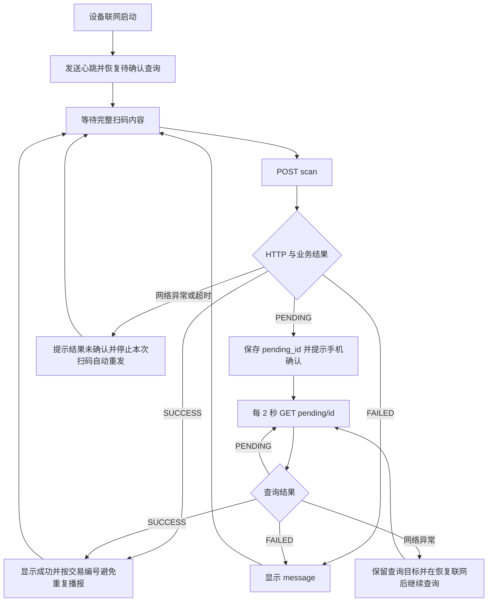

# ESP32 + TTL 串口扫码枪对接文档

本文供设备端工程师实现扫码上报与结果反馈。接口与当前服务端实现一致，适用于 ESP32 通过 HTTP/HTTPS 接入。TTL 串口采集、设备接线、显示屏及语音驱动由设备端实现，本文约定网络接口和业务流程。

## 1. 系统分工与接入准备

```text
员工手机展示就餐码 → 扫码枪读取 → ESP32 → HTTP/HTTPS → 食堂服务端
                                               ← 消费结果 ←
```

- 设备端：读取完整就餐码、上报、解析结果、反馈状态，以及可选的心跳与待确认结果查询。
- 服务端：终端鉴权、员工识别、餐次与价格判断、余额检查、重复扫码处理、扣款和流水记录。
- 员工手机：展示就餐码；需要确认再次消费时，由员工本人确认或取消。

部署前在管理后台“终端与扫码事件”为每台设备创建终端，取得独立 key。设备端配置以下参数：

| 参数 | 示例 | 说明 |
| --- | --- | --- |
| 服务端基础地址 | `https://canteen.example.com` | 设备可访问的网站地址，不包含下面的接口路径 |
| 终端 key | `trm_...` | 使用后台提供的完整值，一台设备对应一个终端 |
| 网络配置 | 按现场配置 | 保证设备能访问服务端 |

所有接口均使用同一个基础地址，无需访问内部 `8081` 端口，也无需运行 Linux Scan Agent。若使用带路径前缀的地址，例如 `https://example.com/canteen`，将接口路径追加到该地址后，反向代理须把此前缀映射到服务端根路径。

HTTP 可用于联调；HTTPS 客户端需要正确配置 CA 信任并校验证书。终端 key 用于设备认证，不应输出到日志。后台重置 key 后，设备需更新配置；停用终端后，其请求会被拒绝。

## 2. 通用约定

所有接口携带请求头：

```http
Authorization: Bearer trm_替换为后台提供的完整key
```

POST 请求还需携带：

```http
Content-Type: application/json
```

请求与响应采用 UTF-8 JSON。金额单位为分，例如 `1200` 表示 `12.00` 元。设备应容忍响应增加字段；可选字段可能不返回，不能要求每个响应都包含全部字段。

## 3. 接口总览

| 方法 | 路径 | 用途 | 实现要求 |
| --- | --- | --- | --- |
| POST | `/api/v1/terminal/scan` | 上报就餐码，取得消费结果 | 必须 |
| POST | `/api/v1/terminal/heartbeat` | 上报设备状态 | 可选，建议实现 |
| GET | `/api/v1/terminal/pending/{pending_id}` | 查询指定待确认请求 | 可选，建议实现 |
| GET | `/api/v1/terminal/pending/recent` | 启动或恢复联网后恢复待确认查询 | 可选，建议实现 |

仅实现扫码接口也可以接入：收到 `PENDING` 后提示“请在手机确认”，员工在手机查看最终结果。不发送心跳时，后台显示“未报告心跳”，不影响扫码。

## 4. 扫码上报

### 4.1 请求

```http
POST /api/v1/terminal/scan
Authorization: Bearer trm_替换为后台提供的完整key
Content-Type: application/json

{"token":"pmt_替换为扫码枪读取的完整就餐码"}
```

| 字段 | 类型 | 必填 | 说明 |
| --- | --- | --- | --- |
| `token` | string | 是 | 扫码枪读取的完整 `pmt_...` 就餐码，不是 URL；服务端允许的最大长度为 128 字节 |

设备应按扫码枪配置的结束符拆分完整扫码内容，去除用于分帧的 CR/LF，保留就餐码原文。不得截断、大小写转换或追加设备标识；超长、不完整输入应整条丢弃。无需提交员工编号、终端编号或金额，终端身份由 key 确定。

### 4.2 响应示例

以下均为 HTTP 200 的业务结果，示例编号及时间仅用于说明。

消费成功：

```json
{
  "status": "SUCCESS",
  "code": "CONSUMED",
  "message": "消费成功",
  "amount_cents": 1200,
  "transaction_id": 123
}
```

消费失败：

```json
{
  "status": "FAILED",
  "code": "INSUFFICIENT_FUNDS",
  "message": "余额不足"
}
```

需要员工在手机确认再次消费：

```json
{
  "status": "PENDING",
  "code": "CONFIRM_REQUIRED",
  "message": "等待员工确认再次消费",
  "amount_cents": 1200,
  "pending_id": "pnd_0123456789abcdef0123456789abcdef",
  "expires_at": "2026-10-20T04:01:00Z"
}
```

### 4.3 结果字段与处理规则

| 字段 | 类型 | 说明 |
| --- | --- | --- |
| `status` | string | `SUCCESS` 已完成、`FAILED` 失败、`PENDING` 等待员工确认 |
| `code` | string | 业务结果代码，用于识别具体原因 |
| `message` | string | 可显示给用户的结果说明 |
| `amount_cents` | integer，可选 | 本次金额，单位为分 |
| `transaction_id` | integer，可选 | 成功交易编号，可用于避免重复播报 |
| `pending_id` | string，可选 | 待确认请求编号，作为不透明字符串保存并原样用于查询 |
| `expires_at` | string，可选 | RFC 3339 时间，表示确认期限；最终状态以服务端查询结果为准 |
| `replayed` | boolean，可选 | 返回的是已有结果，缺省视为 false |
| `duplicate_trigger` | boolean，可选 | 识别为重复触发，缺省视为 false |
| `employee_name`、`meal_code`、`meal_name` | string，可选 | 员工与餐次展示信息 |
| `transaction_no`、`consumption_no`、`occurred_at` | string，可选 | 成功消费的流水及时间展示信息 |

必须先判断 HTTP 状态，再解析业务 `status`。HTTP 200 本身不能作为消费成功依据。

- `SUCCESS`：显示成功及金额；同一 `transaction_id` 不重复播报或打印。
- `FAILED`：显示 `message`，结束本次处理。
- `PENDING`：保存 `pending_id`，提示员工在手机确认；此时本次扣款尚未完成。
- `replayed=true` 或 `duplicate_trigger=true`：显示已有状态，不当作新消费重复播报或打印；如果仍为 `PENDING`，继续跟踪该请求。
- JSON 无法解析、缺少必要字段或出现未知 `status`：提示结果未确认，不提示消费成功。

常见业务代码如下，设备应以 `status` 决定流程，以 `message` 显示说明，不依赖穷举代码列表。

| `code` | 含义 |
| --- | --- |
| `CONSUMED` | 消费成功 |
| `CONFIRM_REQUIRED` | 等待员工确认再次消费 |
| `TOKEN_INVALID` | 无效就餐码 |
| `TOKEN_UNAVAILABLE` | 就餐码已过期或账户不可用 |
| `INSUFFICIENT_FUNDS` | 余额不足 |
| `ACCOUNT_UNAVAILABLE` | 账户不可用 |
| `NO_MEAL` | 当前无可用餐次 |
| `MEALS_SUSPENDED` | 当前未开放供餐 |
| `MODE_DISABLED` | 就餐码消费入口已关闭 |
| `CANCELLED` | 员工已取消再次消费 |
| `PENDING_EXPIRED` | 确认已过期 |
| `MEAL_ENDED` | 原餐次已结束 |

## 5. 待确认结果查询

扫码返回 `PENDING` 时，建议每 2 秒查询一次：

```http
GET /api/v1/terminal/pending/pnd_0123456789abcdef0123456789abcdef
Authorization: Bearer trm_替换为后台提供的完整key
```

响应使用第 4 节的消费结果结构：

1. `PENDING`：继续查询，等待员工在手机确认或取消。
2. `SUCCESS`：本次已完成扣款，显示最终结果，停止查询。
3. `FAILED`：本次失败、取消或过期，显示 `message`，停止查询。

确认期限由服务端控制，使用返回的 `expires_at` 展示倒计时，不在设备上固定假设等待时长。到期后仍应向服务端取得最终状态，避免错过到期前已完成的确认。

查询成功后的响应可能不带 `pending_id`，设备须通过发起请求时保存的编号关联结果；支持多个待确认请求时分别跟踪，避免把上一位员工的结果显示为当前扫码结果。

设备端没有确认扣款接口，不得代替员工确认，也不能通过重复调用扫码接口代替结果查询。

## 6. 心跳

建议联网启动后立即发送一次，此后每 10 秒发送一次：

```http
POST /api/v1/terminal/heartbeat
Authorization: Bearer trm_替换为后台提供的完整key
Content-Type: application/json

{"scanner_status":"READY","voice_status":"UNAVAILABLE"}
```

两个字段均为必填的非空字符串，每个最多 32 字节。扫码枪正常可报告 `READY`，无语音模块报告 `UNAVAILABLE`；心跳成功不代表任何一笔消费成功。

成功响应为 HTTP 200：

```json
{"status":"ok"}
```

此处 `status` 为小写 `ok`，与消费结果的 `SUCCESS/FAILED/PENDING` 不同。

## 7. 启动与恢复联网

启动后、网络恢复后，建议调用：

```http
GET /api/v1/terminal/pending/recent
Authorization: Bearer trm_替换为后台提供的完整key
```

响应结构：

```json
{"items":[]}
```

`items` 元素采用第 4 节的消费结果结构，包含本终端未结束请求及最近两分钟内创建的待确认请求的结果，当前最多返回 100 条，无记录时为空数组。

- 对 `PENDING` 项恢复按编号查询；也可继续查询设备已保存的 `pending_id`。
- 已结束的项用于恢复展示，不能当成新消费重复播报或打印。
- 该接口恢复的是待确认消费记录，不是所有扫码或交易记录，不能保证找回普通扫码请求超时后的结果。
- HTTP 404 不等于未扣款；无法确认时提示员工查看手机结果或请管理员查流水。

## 8. 完整设备流程



心跳、串口采集与待确认查询应能持续运行，避免等待一笔员工确认时阻塞心跳或丢失其他扫码内容。

## 9. 异常与重试

非 200 响应通常为以下结构，反向代理等中间层也可能返回非 JSON 内容，设备应兼容处理：

```json
{"code":"UNAUTHORIZED","message":"terminal credential invalid"}
```

| 情况 | 设备处理 |
| --- | --- |
| HTTP 400 | 检查 JSON、字段、长度或请求编号格式；不盲目重试 |
| HTTP 401 | 检查终端 key、重置情况及启停状态；提示设备认证异常 |
| HTTP 404 | 查询编号未知、不属于本终端或记录不可取得；停止该目标的自动查询，不推断扣款结果 |
| HTTP 405 | 请求方法错误，修正客户端 |
| HTTP 503、其他异常状态 | 不提示消费成功；查询和心跳可在恢复后重试 |
| 连接失败、超时、响应损坏 | 本次扫码结果未确认；保留已知待确认查询目标 |
| 设备断网时扫码 | 提示离线，不缓存扫码后自动补扣 |

扫码 POST 超时可能发生在服务端扣款之后，因此不能显示“未扣款”，也不要自动排队重发。建议文案为“结果未确认，请查看手机记录”。服务端提供重复扫码处理，但设备不能把重复上报作为新的消费意图。

## 10. 联调流程

1. 服务端配置餐次、价格并开启就餐码消费；创建测试员工、充值，并在手机登录展示真实就餐码。
2. 后台创建测试终端，向设备工程师提供基础地址及终端 key。
3. 正常扫码：检查设备按 `SUCCESS` 提示，手机和后台只新增一笔消费。
4. 连续重复扫码：检查已有结果不会按新消费重复播报或打印，后台无意外重复扣款。
5. 同餐次再次消费：员工重新出示就餐码，按服务端规则进入 `PENDING`；分别验证手机确认、取消及等待到期后的结果。紧邻首次消费的扫码可能被判为重复触发。
6. 验证余额不足、无效或过期码、无可用餐次以及消费入口关闭的失败提示。
7. 验证待确认期间断网、设备重启后恢复查询；扫码请求超时不直接提示未扣款，不离线补扣。
8. 验证后台停用终端及重置 key 后旧 key 返回 401，更新 key 后恢复访问。

## 11. 参考资料

- [通用终端 API](terminal-api.md)：包含 curl 调用及其他辅助查询接口。
- [Arduino ESP32 协议调用示例](../examples/esp32-terminal/esp32-terminal.ino)：演示扫码 HTTP 请求与 HTTPS CA 配置；仅为协议示例，不包含 TTL 扫码枪驱动、JSON 业务状态处理、心跳或完整恢复流程，尚未在真实 ESP32 上编译、烧录验证。
